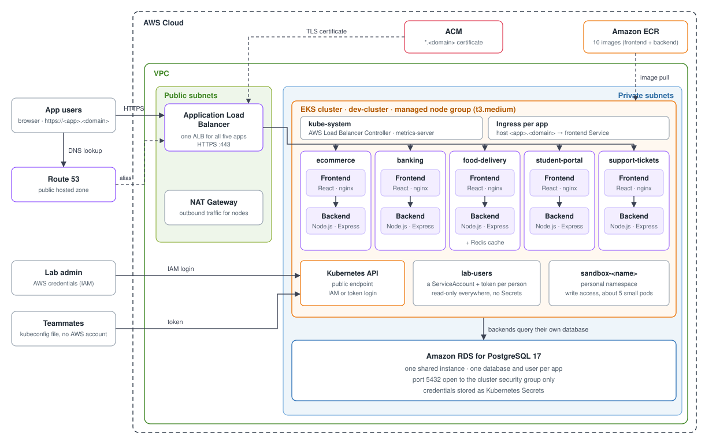

# K8s Assistant Lab

A hands-on Kubernetes troubleshooting lab on AWS. One script deploys five full-stack applications to Amazon EKS. You then break them on purpose and fix them.



Each app has a React frontend served by nginx and a Node.js backend, in its own namespace. They share one Application Load Balancer, one RDS PostgreSQL instance, and an ECR registry. Each app gets its own URL, `https://<app>.<your-domain>`. The full design is in [docs/architecture.md](docs/architecture.md).

Every exercise follows the same loop:

```text
symptom -> scope -> Kubernetes or AWS evidence -> root cause -> fix -> verify recovery
```

> **Cost warning:** the lab creates billable AWS resources (EKS, EC2, NAT Gateway, ALB, RDS). Run [`./scripts/teardown.sh`](#7-destroy-the-lab) when you are done.

## Contents

1. [Check the prerequisites](#1-check-the-prerequisites)
2. [Configure the lab](#2-configure-the-lab)
3. [Launch the lab](#3-launch-the-lab)
4. [Use the kubeconfig](#4-use-the-kubeconfig)
5. [Verify the deployment](#5-verify-the-deployment)
6. [Work through the incident scenarios](#6-work-through-the-incident-scenarios)
7. [Destroy the lab](#7-destroy-the-lab)

## 1. Check the prerequisites

- Bash 4.4 or newer: Linux, WSL, or macOS with Bash from Homebrew. The macOS system Bash 3.2 is too old.
- Terraform, AWS CLI, kubectl, Docker, Helm, jq, `envsubst`, `curl`, and `nslookup`.
- An AWS account with credentials configured.
- A Route 53 **public hosted zone** for your domain, with the registrar's NS records pointing at it.

Resource names are fixed, so run only one lab per AWS account.

```bash
aws sts get-caller-identity
docker info
terraform version
kubectl version --client
helm version
```

## 2. Configure the lab

The only required setting is your domain:

```bash
cp terraform/terraform.tfvars.example terraform/terraform.tfvars
```

Open `terraform/terraform.tfvars` and set `dns_zone_name` to your hosted zone, for example `dns_zone_name = "labs.example.org"`.

Everything else has a default: region `us-east-1`, cluster `dev-cluster`, 3 × `t3.medium` nodes, Kubernetes 1.33, and a `db.t3.micro` PostgreSQL 17 instance. To change a default, add that variable to `terraform.tfvars`. The full list is in [terraform/variables.tf](terraform/variables.tf).

## 3. Launch the lab

From the repository root:

```bash
./scripts/setup.sh
```

The script:

1. Checks your tools, AWS login, `terraform.tfvars`, the hosted zone, and DNS delegation.
2. Finds or requests a `*.<domain>` ACM certificate.
3. Runs `terraform apply` to create the VPC, EKS, ECR, RDS, and IAM resources, and to write the read-only kubeconfig `kubeconfigs/team-readonly.kubeconfig`.
4. Points `kubectl` at the new cluster.
5. Builds the ten images and pushes them to ECR.
6. Creates the namespaces and the access roles from [rbac/](rbac/).
7. Creates one database and user per app and stores the credentials as Kubernetes Secrets.
8. Deploys the five apps and Redis, then waits for every rollout.
9. Installs metrics-server and the AWS Load Balancer Controller, applies the Ingresses, and creates the DNS records.
10. Prints the application URLs and the path of the read-only kubeconfig.

Setup takes 20 minutes or more. You can safely run it again. If a rollout fails, the script names the failing Deployment. Fix the cause and re-run.

## 4. Use the kubeconfig

When setup finishes, you have two ways to connect with `kubectl`:

| Kubeconfig | Where | Access |
|---|---|---|
| Admin | `~/.kube/config`, configured by `setup.sh` | Full cluster admin, logs in with your AWS credentials |
| Read-only | `kubeconfigs/team-readonly.kubeconfig`, created by `setup.sh` | Read everything except Secrets, cannot change anything |

The admin kubeconfig is already active, so `kubectl` commands work right away.

To use the read-only kubeconfig, point `kubectl` at the file:

```bash
export KUBECONFIG=$PWD/kubeconfigs/team-readonly.kubeconfig
kubectl get pods -A                  # works
kubectl get secrets -n banking       # Forbidden: read-only
```

To go back to admin access, run `unset KUBECONFIG`.

The read-only file contains a login token. Keep it out of Git. The `kubeconfigs/` folder is already gitignored.

## 5. Verify the deployment

```bash
kubectl get nodes
kubectl get deployments -A
kubectl get pods -A
kubectl get ingress -A
```

Every Deployment should show all of its replicas Ready. The domain is saved in `.lab-domain`, so you can print the app URLs with:

```bash
for app in ecommerce banking food-delivery student-portal support-tickets; do
  echo "https://${app}.$(cat .lab-domain)"
done
```

Open each URL and confirm the app loads before you break anything. To see what a healthy app looks like:

```bash
kubectl get all -n banking
kubectl get events -n banking
kubectl logs -n banking deploy/banking-backend
kubectl top pods -A
```

## 6. Work through the incident scenarios

Each scenario has a guide that starts from the symptom, and a script in [scripts/chaos/](scripts/chaos/) that causes the incident. Run the script, then diagnose the problem with the guide, without reading ahead to the answer.

| Scenario | Trigger | Main skill |
|---|---|---|
| [Bad container image](docs/incident-scenarios/01-bad-container-image.md) | `./scripts/chaos/bad-deploy.sh <namespace> <deployment> <container>` | ECR and Deployments |
| [Bad ConfigMap rollout](docs/incident-scenarios/02-bad-configmap-rollout.md) | `./scripts/chaos/break-config.sh <app>` | ConfigMaps and health probes |
| [OOMKilled and resource limits](docs/incident-scenarios/03-oomkilled-resource-limits.md) | `./scripts/chaos/shrink-limits.sh <app>` | Resource management |
| [ALB and Ingress routing failure](docs/incident-scenarios/04-alb-ingress-routing.md) | `./scripts/chaos/break-ingress.sh <app>` | ALB and Kubernetes networking |
| [High application latency](docs/incident-scenarios/05-high-application-latency.md) | `./scripts/chaos/inject-latency.sh <app> [ms]` | Application performance |

`<app>` is one of `ecommerce`, `banking`, `food-delivery`, `student-portal`, or `support-tickets`.

To get back to a healthy state:

- `break-config.sh`, `shrink-limits.sh`, and `break-ingress.sh` take `--undo`.
- `./scripts/chaos/reset.sh <app>` clears injected latency and other in-app chaos.
- `bad-deploy.sh` prints the `kubectl` command that reverts it.

The chaos scripts change the cluster, so run them with the admin kubeconfig, not the read-only one.

The [runbooks](docs/runbooks/) walk through each fix step by step, and [DevOps STAR scenarios](docs/devops-star-scenarios.md) describes the same incidents as production write-ups.

## 7. Destroy the lab

Teardown deletes the Ingresses first so the controller can release the ALB. It then removes the controller and the namespaces, and runs `terraform destroy`.

```bash
./scripts/teardown.sh
```

Afterward, check the AWS console for leftover ALBs, target groups, NAT Gateways, Elastic IPs, ECR repositories, or RDS instances.

## Where to find the config

| What | Where |
|---|---|
| Your lab settings (domain, region, nodes, DB size) | `terraform/terraform.tfvars`, created from [terraform.tfvars.example](terraform/terraform.tfvars.example) and gitignored |
| Terraform variables and defaults | [terraform/variables.tf](terraform/variables.tf) |
| AWS infrastructure | [terraform/](terraform/): `vpc.tf`, `eks.tf`, `ecr.tf`, `rds.tf`, `dns.tf`, `acm.tf`, `alb-controller.tf` |
| Read-only kubeconfig | Created by [terraform/kubeconfig.tf](terraform/kubeconfig.tf) at `kubeconfigs/team-readonly.kubeconfig` |
| App runtime settings | `apps/<app>/k8s/configmap.yaml` |
| App Deployments, Services, autoscaling | `apps/<app>/k8s/` |
| Database schema and seed data | `apps/<app>/backend/sql/init.sql` |
| Database credentials | Secret `<app>-db-credentials` in each app namespace, generated by `setup.sh` and never stored in Git |
| Hostname routing | [ingress/](ingress/), one Ingress per app on the shared ALB |
| Namespaces, quotas, limit ranges | [namespaces/](namespaces/) |
| Access roles (RBAC) | [rbac/](rbac/) |
| Incident triggers | [scripts/chaos/](scripts/chaos/) |

Files that are generated locally and gitignored: `.lab-domain`, `terraform/*.tfstate` (contains the RDS master password), and `kubeconfigs/` (the read-only kubeconfig). Never commit them.

## Repository layout

```text
apps/          Application source and Kubernetes manifests
docs/          Architecture, guides, incident scenarios, runbooks, and PDFs
ingress/       One hostname-based Ingress per application
namespaces/    Namespaces, quotas, and limit ranges
rbac/          Cluster access roles
scripts/       Setup, teardown, and chaos triggers
terraform/     VPC, EKS, ECR, RDS, Route 53, IAM, ALB controller, and the read-only kubeconfig
```

## Guides

- [Architecture](docs/architecture.md)
- [Student guide](docs/student-guide.md)
- [Scenario test checklist](docs/testing-the-lab.md)
- [Runbooks](docs/runbooks/)
- [All PDFs](docs/pdf/)
